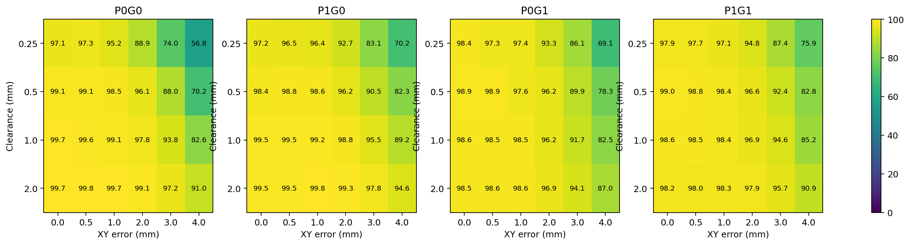
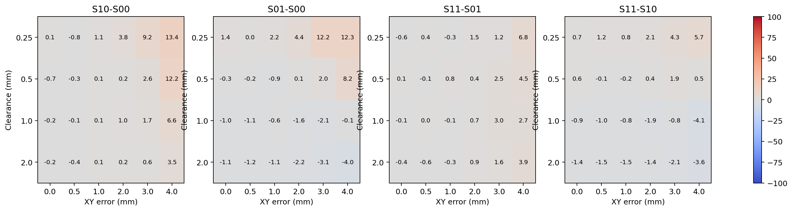
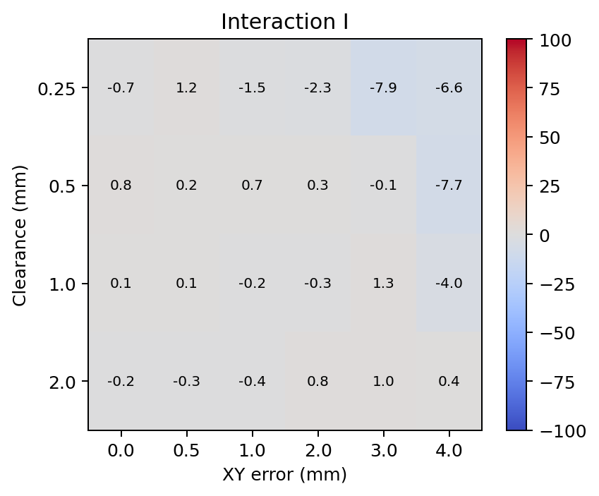

# 四组训练：统一网格评估与交互分析

所有1440个正式评估任务通过文件、checkpoint、配对样本与回合完整性检查。每格每组3个训练seed×5个评估seed×128回合。下面是三个训练seed的等权平均，不是挑选best seed。

区间为5000次配对交叉分层bootstrap：共同抽取训练seed，再共同抽取评估seed与环境，保留四组和配对测试关系。仅3个训练seed，不确定性估计有限；各格比较未做多重校正，逐格显著性作为探索性证据。

| 间隙mm | 误差mm | rho | P0G0 | P1G0 | P0G1 | P1G1 | I pp [95% CI] |
|---|---|---|---|---|---|---|---|
| 0.25 | 0 | 0 | 97.08% | 97.19% | 98.44% | 97.86% | -0.68 [-3.96, 2.45] |
| 0.25 | 0.5 | 4 | 97.29% | 96.51% | 97.29% | 97.71% | 1.20 [-2.50, 5.00] |
| 0.25 | 1 | 8 | 95.21% | 96.35% | 97.45% | 97.14% | -1.46 [-5.00, 2.03] |
| 0.25 | 2 | 16 | 88.91% | 92.66% | 93.33% | 94.79% | -2.29 [-7.08, 3.13] |
| 0.25 | 3 | 24 | 73.96% | 83.12% | 86.15% | 87.40% | -7.92 [-15.31, 0.62] |
| 0.25 | 4 | 32 | 56.77% | 70.16% | 69.11% | 75.89% | -6.61 [-13.91, 0.94] |
| 0.5 | 0 | 0 | 99.11% | 98.39% | 98.85% | 98.96% | 0.83 [-1.15, 2.97] |
| 0.5 | 0.5 | 2 | 99.06% | 98.80% | 98.85% | 98.75% | 0.16 [-1.88, 2.34] |
| 0.5 | 1 | 4 | 98.49% | 98.59% | 97.55% | 98.39% | 0.73 [-3.12, 3.65] |
| 0.5 | 2 | 8 | 96.09% | 96.25% | 96.20% | 96.61% | 0.26 [-2.86, 3.75] |
| 0.5 | 3 | 12 | 87.97% | 90.52% | 89.95% | 92.45% | -0.05 [-5.16, 5.36] |
| 0.5 | 4 | 16 | 70.16% | 82.34% | 78.33% | 82.81% | -7.71 [-14.69, -0.21] |
| 1 | 0 | 0 | 99.69% | 99.53% | 98.65% | 98.59% | 0.10 [-1.67, 1.88] |
| 1 | 0.5 | 1 | 99.58% | 99.53% | 98.49% | 98.49% | 0.05 [-2.24, 2.19] |
| 1 | 1 | 2 | 99.11% | 99.22% | 98.49% | 98.39% | -0.21 [-2.81, 2.08] |
| 1 | 2 | 4 | 97.81% | 98.80% | 96.25% | 96.93% | -0.31 [-4.27, 3.70] |
| 1 | 3 | 6 | 93.80% | 95.47% | 91.67% | 94.64% | 1.30 [-3.59, 5.78] |
| 1 | 4 | 8 | 82.60% | 89.22% | 82.50% | 85.16% | -3.96 [-10.83, 3.39] |
| 2 | 0 | 0 | 99.69% | 99.53% | 98.54% | 98.18% | -0.21 [-2.66, 2.08] |
| 2 | 0.5 | 0.5 | 99.84% | 99.48% | 98.65% | 98.02% | -0.26 [-3.44, 2.50] |
| 2 | 1 | 1 | 99.74% | 99.79% | 98.65% | 98.33% | -0.36 [-3.44, 2.19] |
| 2 | 2 | 2 | 99.11% | 99.27% | 96.93% | 97.86% | 0.78 [-2.50, 4.01] |
| 2 | 3 | 3 | 97.19% | 97.81% | 94.11% | 95.73% | 0.99 [-3.12, 5.78] |
| 2 | 4 | 4 | 91.04% | 94.58% | 87.03% | 90.94% | 0.36 [-5.78, 6.56] |

## 各项收益（百分点，95%区间）

| 间隙/误差 mm | S10−S00 | S01−S00 | S11−S01 | S11−S10 |
|---|---|---|---|---|
| 0.25/0 | 0.10 [-1.41,1.82] | 1.35 [-1.09,3.80] | -0.57 [-2.97,1.72] | 0.68 [-1.41,2.66] |
| 0.25/0.5 | -0.78 [-2.97,1.35] | 0.00 [-2.97,2.76] | 0.42 [-1.82,2.76] | 1.20 [-0.78,3.39] |
| 0.25/1 | 1.15 [-0.94,3.12] | 2.24 [-0.94,5.26] | -0.31 [-3.07,2.66] | 0.78 [-1.09,2.76] |
| 0.25/2 | 3.75 [0.99,6.41] | 4.43 [-0.52,8.91] | 1.46 [-1.98,5.73] | 2.14 [-0.94,5.10] |
| 0.25/3 | 9.17 [5.16,13.28] | 12.19 [5.31,18.18] | 1.25 [-5.83,8.60] | 4.27 [0.31,8.28] |
| 0.25/4 | 13.39 [7.66,19.06] | 12.34 [4.48,19.06] | 6.77 [-1.09,16.36] | 5.73 [1.61,9.74] |
| 0.5/0 | -0.73 [-2.03,0.57] | -0.26 [-1.72,0.99] | 0.10 [-1.41,1.72] | 0.57 [-0.83,1.77] |
| 0.5/0.5 | -0.26 [-1.35,0.68] | -0.21 [-1.56,0.99] | -0.10 [-1.93,1.88] | -0.05 [-1.41,1.30] |
| 0.5/1 | 0.10 [-1.25,1.36] | -0.94 [-3.28,1.35] | 0.83 [-2.29,3.65] | -0.21 [-2.29,1.25] |
| 0.5/2 | 0.16 [-2.29,2.76] | 0.10 [-2.86,2.66] | 0.42 [-2.66,3.91] | 0.36 [-1.67,2.50] |
| 0.5/3 | 2.55 [-0.16,5.26] | 1.98 [-2.97,6.09] | 2.50 [-2.45,8.18] | 1.93 [-0.99,4.84] |
| 0.5/4 | 12.19 [6.67,17.40] | 8.18 [3.28,13.96] | 4.48 [-2.50,12.76] | 0.47 [-3.75,4.84] |
| 1/0 | -0.16 [-0.99,0.62] | -1.04 [-2.34,-0.10] | -0.05 [-1.93,1.88] | -0.94 [-2.24,0.10] |
| 1/0.5 | -0.05 [-0.94,0.94] | -1.09 [-2.50,0.05] | 0.00 [-2.45,2.19] | -1.04 [-2.60,0.16] |
| 1/1 | 0.10 [-0.94,1.04] | -0.62 [-1.93,0.47] | -0.10 [-2.50,2.14] | -0.83 [-2.92,0.57] |
| 1/2 | 0.99 [-0.42,2.55] | -1.56 [-4.38,0.83] | 0.68 [-2.66,4.69] | -1.88 [-4.38,-0.05] |
| 1/3 | 1.67 [-1.36,4.74] | -2.14 [-5.94,1.41] | 2.97 [-2.03,8.59] | -0.83 [-3.12,1.41] |
| 1/4 | 6.61 [2.45,11.20] | -0.10 [-4.69,4.11] | 2.66 [-5.31,11.51] | -4.06 [-8.75,0.73] |
| 2/0 | -0.16 [-0.83,0.47] | -1.15 [-2.34,-0.16] | -0.36 [-2.97,2.03] | -1.35 [-3.18,0.16] |
| 2/0.5 | -0.36 [-1.09,0.21] | -1.20 [-2.50,-0.16] | -0.62 [-3.75,2.03] | -1.46 [-4.22,0.52] |
| 2/1 | 0.05 [-0.47,0.62] | -1.09 [-2.40,0.00] | -0.31 [-3.28,2.19] | -1.46 [-3.70,0.16] |
| 2/2 | 0.16 [-0.78,1.15] | -2.19 [-4.43,-0.52] | 0.94 [-2.50,4.64] | -1.41 [-4.11,0.47] |
| 2/3 | 0.62 [-1.56,3.44] | -3.07 [-6.25,-0.68] | 1.61 [-3.59,8.12] | -2.08 [-5.00,0.47] |
| 2/4 | 3.54 [0.05,7.92] | -4.01 [-8.54,-0.10] | 3.91 [-3.80,12.66] | -3.65 [-7.50,-0.26] |

## 逐格解释

- 间隙0.25mm / 误差0mm：交互方向尚不确定；尚未同时确认联合组优于两个单独组。
- 间隙0.25mm / 误差0.5mm：交互方向尚不确定；尚未同时确认联合组优于两个单独组。
- 间隙0.25mm / 误差1mm：交互方向尚不确定；尚未同时确认联合组优于两个单独组。
- 间隙0.25mm / 误差2mm：交互方向尚不确定；尚未同时确认联合组优于两个单独组。
- 间隙0.25mm / 误差3mm：交互方向尚不确定；尚未同时确认联合组优于两个单独组。
- 间隙0.25mm / 误差4mm：交互方向尚不确定；尚未同时确认联合组优于两个单独组。
- 间隙0.5mm / 误差0mm：交互方向尚不确定；尚未同时确认联合组优于两个单独组。
- 间隙0.5mm / 误差0.5mm：交互方向尚不确定；尚未同时确认联合组优于两个单独组。
- 间隙0.5mm / 误差1mm：交互方向尚不确定；尚未同时确认联合组优于两个单独组。
- 间隙0.5mm / 误差2mm：交互方向尚不确定；尚未同时确认联合组优于两个单独组。
- 间隙0.5mm / 误差3mm：交互方向尚不确定；尚未同时确认联合组优于两个单独组。
- 间隙0.5mm / 误差4mm：负交互区间低于零；尚未同时确认联合组优于两个单独组。
- 间隙1mm / 误差0mm：交互方向尚不确定；尚未同时确认联合组优于两个单独组。
- 间隙1mm / 误差0.5mm：交互方向尚不确定；尚未同时确认联合组优于两个单独组。
- 间隙1mm / 误差1mm：交互方向尚不确定；尚未同时确认联合组优于两个单独组。
- 间隙1mm / 误差2mm：交互方向尚不确定；尚未同时确认联合组优于两个单独组。
- 间隙1mm / 误差3mm：交互方向尚不确定；尚未同时确认联合组优于两个单独组。
- 间隙1mm / 误差4mm：交互方向尚不确定；尚未同时确认联合组优于两个单独组。
- 间隙2mm / 误差0mm：交互方向尚不确定；尚未同时确认联合组优于两个单独组。
- 间隙2mm / 误差0.5mm：交互方向尚不确定；尚未同时确认联合组优于两个单独组。
- 间隙2mm / 误差1mm：交互方向尚不确定；尚未同时确认联合组优于两个单独组。
- 间隙2mm / 误差2mm：交互方向尚不确定；尚未同时确认联合组优于两个单独组。
- 间隙2mm / 误差3mm：交互方向尚不确定；尚未同时确认联合组优于两个单独组。
- 间隙2mm / 误差4mm：交互方向尚不确定；尚未同时确认联合组优于两个单独组。

## 辅助指标

| 间隙/误差/组 | 曾成功未保持 | 深度mm | XY误差mm | 平均力N | 峰值力P95 N | 首次成功时间s（仅曾成功回合） | 从未成功回合 |
|---|---|---|---|---|---|---|---|
| 0.25/0/P0G0 | 0 | 46.39 | 0.17 | 3.69 | 17.57 | 2.5221389063310213 | 56 |
| 0.25/0/P1G0 | 2 | 46.43 | 0.15 | 3.41 | 17.69 | 2.583476229353431 | 52 |
| 0.25/0/P0G1 | 5 | 46.55 | 0.14 | 3.18 | 18.31 | 2.317467143604812 | 25 |
| 0.25/0/P1G1 | 7 | 46.56 | 0.11 | 3.26 | 17.77 | 2.343867215978758 | 34 |
| 0.25/0.5/P0G0 | 1 | 46.46 | 0.14 | 3.72 | 17.73 | 2.5507046154886086 | 51 |
| 0.25/0.5/P1G0 | 0 | 46.31 | 0.15 | 3.46 | 17.76 | 2.5749956419579867 | 67 |
| 0.25/0.5/P0G1 | 5 | 46.29 | 0.16 | 3.24 | 18.42 | 2.3431928667612274 | 47 |
| 0.25/0.5/P1G1 | 4 | 46.48 | 0.13 | 3.31 | 17.75 | 2.3620923265497735 | 40 |
| 0.25/1/P0G0 | 0 | 45.99 | 0.17 | 3.87 | 17.66 | 2.6657915392837586 | 92 |
| 0.25/1/P1G0 | 6 | 46.34 | 0.15 | 3.55 | 17.86 | 2.707327732270391 | 64 |
| 0.25/1/P0G1 | 7 | 46.34 | 0.16 | 3.35 | 18.38 | 2.4595315472576944 | 42 |
| 0.25/1/P1G1 | 9 | 46.38 | 0.13 | 3.39 | 17.66 | 2.466951395779562 | 46 |
| 0.25/2/P0G0 | 4 | 44.66 | 0.29 | 4.36 | 17.97 | 3.105396623189236 | 209 |
| 0.25/2/P1G0 | 5 | 45.50 | 0.23 | 3.93 | 18.36 | 3.0437221389781732 | 136 |
| 0.25/2/P0G1 | 9 | 45.28 | 0.24 | 3.86 | 18.62 | 2.8103277485348133 | 119 |
| 0.25/2/P1G1 | 11 | 45.76 | 0.18 | 3.78 | 17.90 | 2.821336399297907 | 89 |
| 0.25/3/P0G0 | 5 | 40.63 | 0.63 | 5.29 | 18.59 | 3.6483276788393657 | 495 |
| 0.25/3/P1G0 | 4 | 42.93 | 0.42 | 4.69 | 18.95 | 3.5275418598204853 | 320 |
| 0.25/3/P0G1 | 14 | 42.87 | 0.54 | 4.71 | 18.92 | 3.4156676524405856 | 252 |
| 0.25/3/P1G1 | 16 | 43.49 | 0.46 | 4.56 | 18.75 | 3.343447644391054 | 226 |
| 0.25/4/P0G0 | 6 | 34.07 | 1.55 | 6.35 | 18.97 | 4.294404120775905 | 824 |
| 0.25/4/P1G0 | 3 | 38.58 | 0.86 | 5.70 | 19.38 | 4.219210102425682 | 570 |
| 0.25/4/P0G1 | 14 | 37.06 | 1.36 | 5.92 | 19.17 | 4.175192864015865 | 579 |
| 0.25/4/P1G1 | 15 | 38.91 | 1.13 | 5.57 | 18.86 | 4.094701311024635 | 448 |
| 0.5/0/P0G0 | 0 | 46.66 | 0.24 | 3.40 | 17.57 | 2.0224909160679663 | 17 |
| 0.5/0/P1G0 | 0 | 46.58 | 0.23 | 3.10 | 17.52 | 2.025022166976858 | 31 |
| 0.5/0/P0G1 | 7 | 46.57 | 0.24 | 2.94 | 18.49 | 1.9833421898013337 | 15 |
| 0.5/0/P1G1 | 9 | 46.63 | 0.23 | 3.01 | 17.58 | 1.9957046653351402 | 11 |
| 0.5/0.5/P0G0 | 1 | 46.63 | 0.24 | 3.42 | 17.34 | 2.0405326026461967 | 17 |
| 0.5/0.5/P1G0 | 1 | 46.66 | 0.25 | 3.11 | 17.85 | 2.050790415925648 | 22 |
| 0.5/0.5/P0G1 | 8 | 46.55 | 0.24 | 2.96 | 18.57 | 1.9935293147596458 | 14 |
| 0.5/0.5/P1G1 | 10 | 46.57 | 0.23 | 3.02 | 17.78 | 2.017628652288931 | 14 |
| 0.5/1/P0G0 | 0 | 46.48 | 0.27 | 3.49 | 17.48 | 2.0838358273965096 | 29 |
| 0.5/1/P1G0 | 3 | 46.63 | 0.24 | 3.20 | 17.66 | 2.1702532824207457 | 24 |
| 0.5/1/P0G1 | 16 | 46.28 | 0.26 | 3.10 | 18.61 | 2.0680431689516836 | 31 |
| 0.5/1/P1G1 | 15 | 46.57 | 0.22 | 3.10 | 17.56 | 2.0980743416780685 | 16 |
| 0.5/2/P0G0 | 1 | 45.74 | 0.37 | 3.89 | 17.96 | 2.4561214766032258 | 74 |
| 0.5/2/P1G0 | 2 | 46.13 | 0.30 | 3.54 | 18.48 | 2.4206848138087507 | 70 |
| 0.5/2/P0G1 | 14 | 45.84 | 0.34 | 3.48 | 18.68 | 2.380763158306263 | 59 |
| 0.5/2/P1G1 | 15 | 46.09 | 0.30 | 3.43 | 17.68 | 2.4087701834459354 | 50 |
| 0.5/3/P0G0 | 4 | 43.32 | 0.66 | 4.67 | 18.62 | 3.0728885302583073 | 227 |
| 0.5/3/P1G0 | 7 | 44.57 | 0.50 | 4.18 | 18.96 | 2.9082332033140954 | 175 |
| 0.5/3/P0G1 | 23 | 43.79 | 0.63 | 4.28 | 19.29 | 2.884838249376842 | 170 |
| 0.5/3/P1G1 | 19 | 44.66 | 0.48 | 4.08 | 18.42 | 2.8995170610538428 | 126 |
| 0.5/4/P0G0 | 7 | 37.66 | 1.48 | 5.78 | 18.88 | 3.6505171875833935 | 566 |
| 0.5/4/P1G0 | 14 | 41.67 | 0.85 | 5.10 | 19.81 | 3.6086940236226144 | 325 |
| 0.5/4/P0G1 | 40 | 39.63 | 1.29 | 5.34 | 19.29 | 3.527893103890777 | 376 |
| 0.5/4/P1G1 | 24 | 40.91 | 1.05 | 5.03 | 19.40 | 3.5326313343559206 | 306 |
| 1/0/P0G0 | 0 | 46.64 | 0.43 | 3.14 | 17.90 | 1.6639847659828022 | 6 |
| 1/0/P1G0 | 2 | 46.71 | 0.43 | 2.88 | 17.74 | 1.7007493519434054 | 7 |
| 1/0/P0G1 | 16 | 46.55 | 0.42 | 2.73 | 18.46 | 1.6951833364851188 | 10 |
| 1/0/P1G1 | 19 | 46.57 | 0.42 | 2.80 | 17.72 | 1.7261855896235012 | 8 |
| 1/0.5/P0G0 | 1 | 46.68 | 0.43 | 3.18 | 17.76 | 1.7068828263958273 | 7 |
| 1/0.5/P1G0 | 3 | 46.71 | 0.43 | 2.90 | 17.88 | 1.7216650191207914 | 6 |
| 1/0.5/P0G1 | 18 | 46.53 | 0.42 | 2.75 | 18.36 | 1.6948490553716518 | 11 |
| 1/0.5/P1G1 | 23 | 46.65 | 0.40 | 2.80 | 17.87 | 1.7468130521266065 | 6 |
| 1/1/P0G0 | 2 | 46.56 | 0.45 | 3.25 | 17.87 | 1.7478216188160454 | 15 |
| 1/1/P1G0 | 4 | 46.62 | 0.44 | 2.98 | 18.03 | 1.7841453731465926 | 11 |
| 1/1/P0G1 | 16 | 46.50 | 0.42 | 2.84 | 18.67 | 1.767593175250945 | 13 |
| 1/1/P1G1 | 19 | 46.56 | 0.41 | 2.87 | 17.73 | 1.8037038014369942 | 12 |
| 1/2/P0G0 | 3 | 46.09 | 0.53 | 3.60 | 18.12 | 2.033918238586089 | 39 |
| 1/2/P1G0 | 4 | 46.50 | 0.43 | 3.21 | 18.47 | 2.018762165593323 | 19 |
| 1/2/P0G1 | 32 | 45.88 | 0.51 | 3.22 | 19.11 | 2.0143263504543203 | 40 |
| 1/2/P1G1 | 29 | 46.22 | 0.45 | 3.17 | 18.25 | 2.0880424420984967 | 30 |
| 1/3/P0G0 | 5 | 44.72 | 0.75 | 4.21 | 18.69 | 2.580767951006377 | 114 |
| 1/3/P1G0 | 8 | 45.53 | 0.56 | 3.74 | 19.05 | 2.4158972890593318 | 79 |
| 1/3/P0G1 | 61 | 44.66 | 0.73 | 3.85 | 19.47 | 2.461028871236431 | 99 |
| 1/3/P1G1 | 32 | 45.46 | 0.59 | 3.67 | 18.74 | 2.5221562592192814 | 71 |
| 1/4/P0G0 | 13 | 40.47 | 1.41 | 5.21 | 19.04 | 3.1536378597676418 | 321 |
| 1/4/P1G0 | 10 | 43.28 | 0.94 | 4.56 | 19.85 | 3.0438384262199536 | 197 |
| 1/4/P0G1 | 73 | 41.19 | 1.29 | 4.86 | 19.55 | 3.0593443614715685 | 263 |
| 1/4/P1G1 | 51 | 41.92 | 1.21 | 4.63 | 19.28 | 3.094424842727566 | 234 |
| 2/0/P0G0 | 1 | 46.63 | 0.76 | 2.91 | 17.79 | 1.4427502963312613 | 5 |
| 2/0/P1G0 | 6 | 46.69 | 0.77 | 2.67 | 17.74 | 1.461867581666231 | 3 |
| 2/0/P0G1 | 24 | 46.65 | 0.78 | 2.49 | 18.42 | 1.4635352245638913 | 4 |
| 2/0/P1G1 | 33 | 46.60 | 0.77 | 2.58 | 17.41 | 1.520299005744604 | 2 |
| 2/0.5/P0G0 | 1 | 46.68 | 0.74 | 2.93 | 17.54 | 1.4734446401702972 | 2 |
| 2/0.5/P1G0 | 7 | 46.68 | 0.78 | 2.68 | 17.71 | 1.4673622783174352 | 3 |
| 2/0.5/P0G1 | 24 | 46.68 | 0.78 | 2.52 | 18.73 | 1.4978103020516873 | 2 |
| 2/0.5/P1G1 | 35 | 46.60 | 0.77 | 2.59 | 17.49 | 1.5307251760968332 | 3 |
| 2/1/P0G0 | 1 | 46.65 | 0.75 | 2.99 | 17.87 | 1.5026792756326512 | 4 |
| 2/1/P1G0 | 3 | 46.70 | 0.75 | 2.73 | 17.97 | 1.5187424838139154 | 1 |
| 2/1/P0G1 | 21 | 46.59 | 0.79 | 2.58 | 18.67 | 1.5315579616058588 | 5 |
| 2/1/P1G1 | 30 | 46.58 | 0.77 | 2.63 | 17.79 | 1.5745569166413687 | 2 |
| 2/2/P0G0 | 3 | 46.44 | 0.80 | 3.24 | 17.93 | 1.7060161836500058 | 14 |
| 2/2/P1G0 | 5 | 46.57 | 0.78 | 2.93 | 18.51 | 1.6723182509857468 | 9 |
| 2/2/P0G1 | 40 | 46.28 | 0.81 | 2.89 | 18.94 | 1.7252674986035619 | 19 |
| 2/2/P1G1 | 37 | 46.54 | 0.77 | 2.81 | 18.08 | 1.7650662053975283 | 4 |
| 2/3/P0G0 | 4 | 45.64 | 0.94 | 3.73 | 18.55 | 2.0906239954226793 | 50 |
| 2/3/P1G0 | 11 | 46.22 | 0.82 | 3.32 | 19.34 | 1.9760721043785645 | 31 |
| 2/3/P0G1 | 67 | 45.64 | 0.90 | 3.35 | 19.32 | 2.045926827185945 | 46 |
| 2/3/P1G1 | 58 | 46.15 | 0.82 | 3.21 | 18.54 | 2.1310127752239696 | 24 |
| 2/4/P0G0 | 14 | 43.32 | 1.33 | 4.52 | 19.32 | 2.6477867515755564 | 158 |
| 2/4/P1G0 | 15 | 44.90 | 1.02 | 3.96 | 20.23 | 2.4638632276812125 | 89 |
| 2/4/P0G1 | 93 | 43.32 | 1.26 | 4.21 | 19.91 | 2.56791396925644 | 156 |
| 2/4/P1G1 | 62 | 44.23 | 1.21 | 3.94 | 19.15 | 2.6530606143044686 | 112 |

负交互不等于联合组更差，需结合联合组相对两个单独组的绝对表现和区间；接近100%时存在天花板效应。全成功数据的经验bootstrap可能退化。原FORGE成功判据未改，额外完整几何装配判据尚未认证，因此这些图表不证明无穿透或实机成功。第7维策略成功预测不作评估标签。0mm只关闭XY孔位误差，其他随机化包括Z偏置保留。

每训练seed成功率和全部统计数据见 summary.json；逐回合记录见 results/。

## 训练完成记录

每组使用3个训练seed、128个环境和200轮预算。评估只使用第200轮权重，不按评估结果挑选checkpoint。训练回报不等于装配成功率。

| 组别 | 训练seed | 日志最后轮次 | 最后记录的best reward | checkpoint | SHA256 |
|---|---|---|---|---|---|
| P0G0 | 0 | 200 | 370.19412 | `/home/masais/Xinyu/Isaacsim/forge_insertion/Pose_Uncertainty_Physical_Clearance/training/P0G0/seed_0/logs/rl_games/Forge/test/nn/last_Forge_ep_200_rew__363.9021_.pth` | `44ec93581f0123a1bad94ff70751e554e7a98fe59d15065c56ba1b7a06395261` |
| P1G0 | 0 | 200 | 363.03992 | `/home/masais/Xinyu/Isaacsim/forge_insertion/Pose_Uncertainty_Physical_Clearance/training/P1G0/seed_0/logs/rl_games/Forge/test/nn/last_Forge_ep_200_rew__339.542_.pth` | `c75c1587a6d7e228132b9bb220e38de75e58c4fabf5efb268eea2db492e75920` |
| P0G1 | 0 | 200 | 358.45612 | `/home/masais/Xinyu/Isaacsim/forge_insertion/Pose_Uncertainty_Physical_Clearance/training/P0G1/seed_0/logs/rl_games/Forge/test/nn/last_Forge_ep_200_rew__350.7975_.pth` | `3f5099802407068a23af5364a9984fbcf25247f6e6c3455ea5901efb76f6e436` |
| P1G1 | 0 | 200 | 352.67047 | `/home/masais/Xinyu/Isaacsim/forge_insertion/Pose_Uncertainty_Physical_Clearance/training/P1G1/seed_0/logs/rl_games/Forge/test/nn/last_Forge_ep_200_rew__342.57205_.pth` | `e1a7728d7637d7fde8f09c14312f9a3836a99b2b57861c558d5a2719e038ffa7` |
| P0G0 | 1 | 200 | 365.80136 | `/home/masais/Xinyu/Isaacsim/forge_insertion/Pose_Uncertainty_Physical_Clearance/training/P0G0/seed_1/logs/rl_games/Forge/test/nn/last_Forge_ep_200_rew__360.81424_.pth` | `20d2cc1db30a77929a4148d225d66ee479095e6f8ea430578f6bc025df82cbc1` |
| P1G0 | 1 | 200 | 363.09473 | `/home/masais/Xinyu/Isaacsim/forge_insertion/Pose_Uncertainty_Physical_Clearance/training/P1G0/seed_1/logs/rl_games/Forge/test/nn/last_Forge_ep_200_rew__348.4978_.pth` | `d08e7b525475adce14d6adb924ce4217adda2f9c2b2f726aa79ac89ee2fc7c16` |
| P0G1 | 1 | 200 | 359.3484 | `/home/masais/Xinyu/Isaacsim/forge_insertion/Pose_Uncertainty_Physical_Clearance/training/P0G1/seed_1/logs/rl_games/Forge/test/nn/last_Forge_ep_200_rew__348.5164_.pth` | `c9a3b1cb65801a7782b336363a04c8ba07872b60e416ad21349f676b62a3cb8e` |
| P1G1 | 1 | 200 | 354.40363 | `/home/masais/Xinyu/Isaacsim/forge_insertion/Pose_Uncertainty_Physical_Clearance/training/P1G1/seed_1/logs/rl_games/Forge/test/nn/last_Forge_ep_200_rew__340.76245_.pth` | `68694cf8cdcf9b60273905b30e54ff4e7f85c48fb32361aa82ccd6be40e93726` |
| P0G0 | 2 | 200 | 367.15067 | `/home/masais/Xinyu/Isaacsim/forge_insertion/Pose_Uncertainty_Physical_Clearance/training/P0G0/seed_2/logs/rl_games/Forge/test/nn/last_Forge_ep_200_rew__357.75912_.pth` | `b1519e692123f9f5077e3defb6558b7487fcd06462d8216d08abf43bc2d1e955` |
| P1G0 | 2 | 200 | 355.47668 | `/home/masais/Xinyu/Isaacsim/forge_insertion/Pose_Uncertainty_Physical_Clearance/training/P1G0/seed_2/logs/rl_games/Forge/test/nn/last_Forge_ep_200_rew__355.4716_.pth` | `9767d5b4ca2c15a172fbabfb4fd5ecbfcc8e2a48a01875afa0fb64e7efd04aeb` |
| P0G1 | 2 | 200 | 358.3202 | `/home/masais/Xinyu/Isaacsim/forge_insertion/Pose_Uncertainty_Physical_Clearance/training/P0G1/seed_2/logs/rl_games/Forge/test/nn/last_Forge_ep_200_rew__350.08368_.pth` | `8f9d13dcf8da76d209a7519ef9a4df0764581ac46d21549d7ce277a38fe4e2e2` |
| P1G1 | 2 | 200 | 344.2137 | `/home/masais/Xinyu/Isaacsim/forge_insertion/Pose_Uncertainty_Physical_Clearance/training/P1G1/seed_2/logs/rl_games/Forge/test/nn/last_Forge_ep_200_rew__336.01483_.pth` | `5a116895b7ef77e6f0d89eb48772b9c9f236d5357e17cc3e6e8cb8b9159de202` |

## 图表

来源锁定文件：manifest.json、models.json、integrity.json。训练原始日志与TensorBoard记录保存在上一级training目录。
