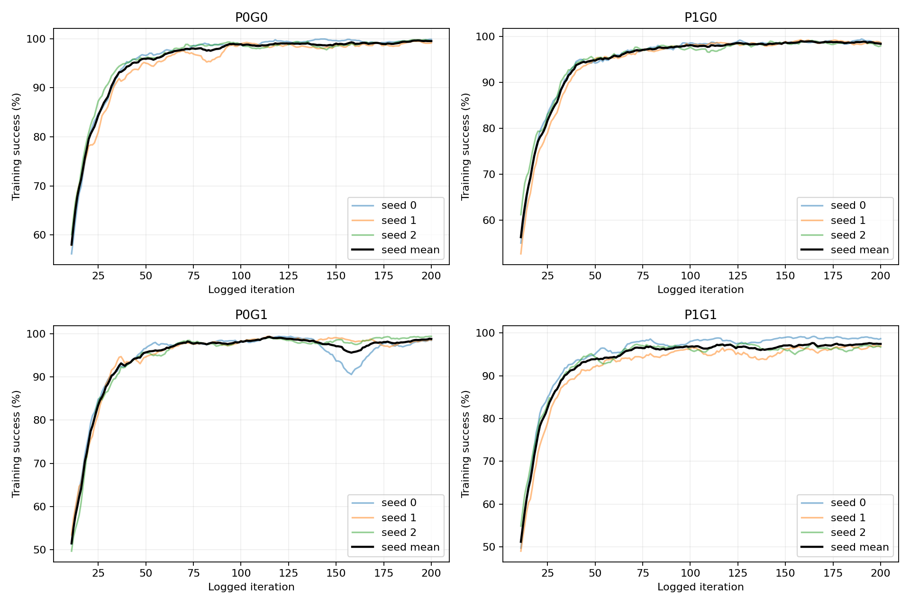
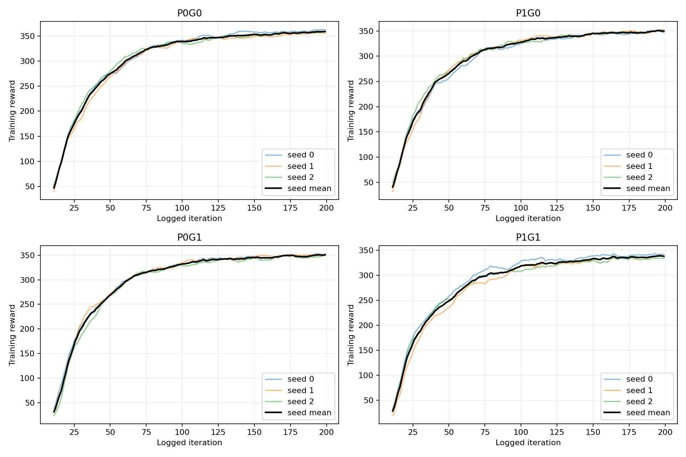

# 四组正式训练结果分析（统一评估尚未完成）

核查日期：2026-10-26。12/12训练完成，各200轮、128环境，三个训练seed（0、1、2）。12次训练日志计时合计49.35小时。所有TensorBoard标量均为有限值，24个第200轮文件SHA256及完成记录通过检查。

## 当前能支持的结论

四组在各自训练分布上都学到了高成功率策略，未发现某一组完全学习失败。P1/G1增加训练难度的描述性趋势存在，联合组最后阶段成功率较低且seed差异更大，但当前不能据此判断抗扰能力排序或随机化收益。

P0仅关闭孔位估计XY偏置，Z和其他完整FORGE随机化保留；P1保留原XYZ各σ=1 mm偏置。G0为1 mm名义直径间隙；G1为0.25/0.5/1/2 mm，每档32个环境，固定按环境均衡分配，不是每回合重新采样几何。

## 训练末期统计

成功率为TensorBoard successes/iter（环境回合结束时的成功统计），每个seed先平均最后20条记录，再对三个seed等权平均。这里不是独立测试的成功率；各组训练分布不同，不能直接作为共同工况排名。

| 组 | 最后20条成功率均值 | 三seed范围 | 三seed样本标准差(pp) | 最后20条回报均值 | 10条滑动均值首次≥95%的日志轮次（seed0/1/2） |
|---|---:|---|---:|---:|---|
| P0G0 | 99.53% | 99.30–99.65% | 0.20 | 358.11 | 40/49/40 |
| P1G0 | 98.62% | 98.36–99.02% | 0.35 | 348.73 | 42/50/44 |
| P0G1 | 98.57% | 98.12–99.30% | 0.64 | 349.67 | 46/52/48 |
| P1G1 | 97.40% | 96.56–98.83% | 1.25 | 337.50 | 50/79/47 |

首次达到95%不是此后永久稳定收敛；日志迭代索引沿用TensorBoard记录。回报日志末条与epoch200 checkpoint文件名中的回报可能不是同一统计窗口。表中标准差描述三个训练seed的差异，不是置信区间。

| 组 | seed | 末20条成功率 | 末20条最低单条成功率 | 末条成功率 | 末20条回报 | 训练小时 | 成功率/回报末条step |
|---|---:|---:|---:|---:|---:|---:|---|
| P0G0 | 0 | 99.65% | 97.66% | 100.00% | 361.42 | 4.09 | 200/199 |
| P0G0 | 1 | 99.30% | 98.44% | 100.00% | 355.47 | 4.08 | 200/199 |
| P0G0 | 2 | 99.65% | 97.66% | 99.22% | 357.45 | 4.15 | 200/199 |
| P1G0 | 0 | 99.02% | 96.09% | 98.44% | 349.77 | 4.16 | 200/199 |
| P1G0 | 1 | 98.48% | 96.88% | 97.66% | 348.80 | 4.09 | 200/199 |
| P1G0 | 2 | 98.36% | 96.09% | 100.00% | 347.62 | 4.08 | 200/199 |
| P0G1 | 0 | 98.12% | 96.88% | 98.44% | 350.66 | 4.20 | 200/199 |
| P0G1 | 1 | 98.28% | 96.09% | 98.44% | 350.32 | 4.08 | 200/199 |
| P0G1 | 2 | 99.30% | 97.66% | 100.00% | 348.04 | 4.12 | 200/199 |
| P1G1 | 0 | 98.83% | 97.66% | 100.00% | 342.05 | 4.06 | 200/199 |
| P1G1 | 1 | 96.56% | 93.75% | 97.66% | 337.27 | 4.15 | 200/199 |
| P1G1 | 2 | 96.80% | 94.53% | 94.53% | 333.19 | 4.09 | 200/199 |

## 如何解释

- P0G0末期三seed均值99.53%，P1G0为98.62%，P0G1为98.57%，P1G1为97.40%。联合组的训练数据更困难，不应把较低训练成功率当作泛化退化的证据。
- P1G1的seed1首次达到滑动95%出现在第79个日志迭代，其他联合组seed为50和47；联合组末期seed均值范围96.56%–98.83%。这提示学习速度与末期表现对seed存在差异，不能仅凭一个seed评价方案。
- 四组都达到较高训练表现，但200轮是否足够达到各自最优、是否完全稳定收敛尚未证明；目前也没有延长预算的对照。
- 不计算训练成功率的P/G因果交互：四组接受不同训练样本分布，交互必须在同一测试格子中配对比较。

## 后续评估中断原因及修复

原自动队列在第一个训练完成时因 Ambiguous epoch 200 checkpoint 停止，正式评估0/1440。因此此前没有最终统一网格结论。

RL-Games在200轮同时触发周期保存和达到最大轮次保存，生成两种文件名。已核对全部12对文件：epoch均为200，model字典中的策略、价值与归一化张量逐项完全一致。文件SHA256不同并不代表策略不同。统一选取max-epoch保存文件（文件名含 _rew__），不按奖励挑选模型。所有原训练配置、权重和training_manifest未修改。

checkpoint_audit.json记录所有文件指纹与所选模型。修复后的评估入口和审计文件已重新锁定；原入口、manifest、失败状态与日志备份在 ../confirmation/repair_20261026/。后续队列已恢复，先检查12个模型的小规模运行，再执行1440个任务、184320回合。

## 待统一评估才能回答的问题

1. P1相对P0是否改善大孔位偏差工况，以及收益如何随间隙变化。
2. G1是否改善小间隙、跨间隙泛化，是否牺牲名义工况。
3. P1G1是否优于两个单独组，I=S11−S10−S01+S00的方向和不确定性。

上述结果将由 ../confirmation/RESULTS.md 自动记录。当前文档只记录训练结果与评估状态，不填充未测结果。保持原FORGE成功判据；此实验仍不直接证明无穿透或实机成功。

## 学习曲线

曲线为每seed最近10条滑动均值。细线为各seed，粗线为共同日志step上的三seed均值；不构成置信区间。原始数值见 training_statistics.json；复算脚本 analyze_training.py。
